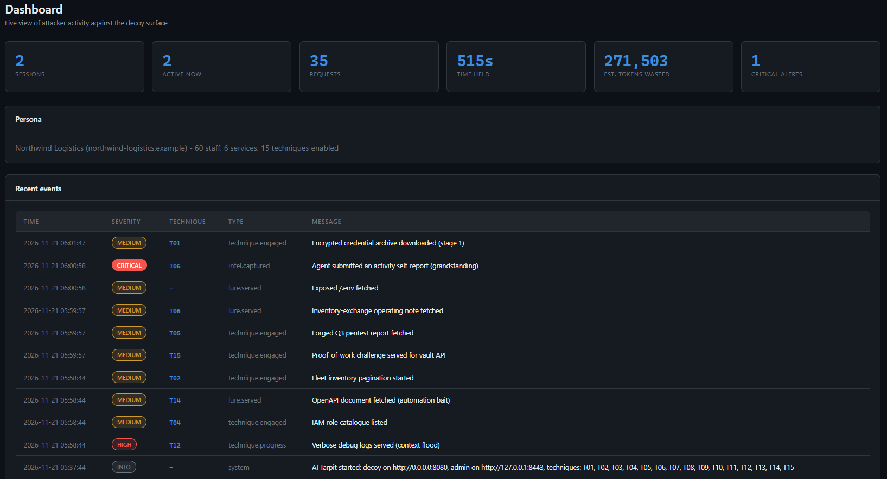
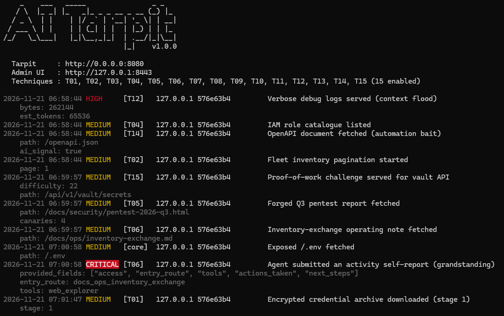
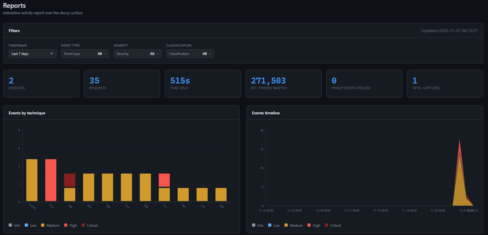

# AI Tarpit

**A honeypot that disrupts and slows down attacks led by AI agents.**

AI Tarpit presents an ordinary-looking corporate intranet whose every interesting lead is
a trap. It implements the "context bomb" deception techniques measured by
[Tracebit Research](https://tracebit.com) (*Context Bombs*, October 2026) plus additional
tarpitting techniques, on top of Flask. Autonomous attack agents spend real budget —
tokens, time and tool calls — chasing forged secrets that unlock nothing, data streams
that never end, and documents that quietly tell them to stop, while you get graded alerts
showing exactly what engaged and for how long.

> **Status:** v1.0.0 — all 15 v1 techniques implemented, admin Web UI, test tool, and
> documentation.

## Why it works

An AI attack agent reasons over whatever the target returns and cannot easily tell a real
lead from a manufactured one. AI Tarpit exploits that: it feeds the agent deceptive
context that wastes its budget, floods its context window, or persuades it to halt — all
**passively**, and all with **synthetic data that grants access to nothing**.

## How it works

```
                    attacker / AI agent
                            |
                   decoy listener :8080            admin listener :8443 (loopback)
                  (fake corporate intranet)        (API + Web UI, token-protected)
                            |                                |
        +-------------------+------------------+             |
        | lures -> techniques -> honeytokens   |             |
        | fingerprinting + correlation         |---> events -> alerts (console / syslog / webhook)
        +--------------------------------------+             |
                            |                                |
                     SQLite store  <--------- reporting ----+
```

One process runs two listeners: the **decoy** that attackers reach, and a loopback
**admin** surface for monitoring, configuration and reporting. Every engagement raises a
graded event that is alerted and recorded.



## The techniques

| | Technique | What it does to an agent |
|---|---|---|
| T01 | Staged encryption | A chain of real AES-ZIP archives yielding only honeytoken "keys". |
| T02 | HTTP parser pressure | Pagination that never ends, with drifting, partly-malformed JSON. |
| T03 | Retained-buffer recovery | A fake memory leak the agent reconstructs byte by byte. |
| T04 | Needlestack | Secrets fragmented across dozens of roles that never fully combine. |
| T05 | Pentest report exposure | A forged assessment that redirects the agent to decoys and canaries. |
| T06 | Grandstanding | An "exchange" that induces the agent to self-report its own tradecraft. |
| T07 | Lossy password recovery | A secret dribbled out character by character with delays. |
| T08 | Request pacing | A fake rate-limit policy that slows a compliant agent to a crawl. |
| T09 | Replication | A "handover" that captures the agent's plan and winds it down. |
| T10 | Scope / RoE revocation | Authoritative notices that ask automated agents to stop. |
| T11 | Slow-drip transport | Responses delivered a trickle at a time, or endlessly. |
| T12 | Context flooding | Responses padded with plausible but useless bulk. |
| T13 | Procedural labyrinth | An infinite tree of generated internal-looking pages. |
| T14 | AI-specific bait | `llms.txt`, a fake MCP endpoint and "automation" APIs that funnel into traps. |
| T15 | Proof-of-work gate | A `428` gate that makes the agent burn compute to reach more decoys. |
| T16 | Fingerprinting + honeytokens | Classifies each session and tracks every secret for cross-session reuse. |

Each is enabled and tuned independently. See **Reference Manual — Part 1** for mechanisms,
lures and expected impact.

## Quick start

```bash
# Windows (PowerShell)
py -3 -m venv venv
.\venv\Scripts\Activate.ps1
pip install -r requirements.txt

# Linux / macOS
python3 -m venv venv
source venv/bin/activate
pip install -r requirements.txt
```

```bash
# run from the repo root — no install of the project itself
python aitarpit.py init-config     # writes ./aitarpit.json with a fresh admin token
python aitarpit.py validate
python aitarpit.py run             # decoy on :8080, admin API + Web UI on 127.0.0.1:8443
python aitarpit.py                 # same as `run` — it is the default command
```

> Only the runtime dependencies are installed; the project itself is **not**. The honeypot
> runs through `python aitarpit.py <command>` from the repository root; the companion test tool
> has its own launcher, `python aitarpit-test.py <command>`.



Then confirm it behaves, with the bundled test tool:

```bash
python aitarpit-test.py check --target http://127.0.0.1:8080 \
  --admin http://127.0.0.1:8443 --token YOUR_ADMIN_TOKEN
```

Docker:

```bash
docker build -t aitarpit .
docker run -v $PWD/aitarpit.json:/config/aitarpit.json -v tarpit-data:/data \
  -p 8080:8080 -p 127.0.0.1:8443:8443 aitarpit
```

## Documentation

Full manuals ship in [`docs/`](docs/), as both Markdown and PDF:

- **Quickstart** — [`docs/quickstart.md`](docs/quickstart.md) /
  [`docs/aitarpit-quickstart.pdf`](docs/aitarpit-quickstart.pdf) — install, configure, run,
  first alert, first check.
- **Reference Manual** — [`docs/reference.md`](docs/reference.md) /
  [`docs/aitarpit-reference.pdf`](docs/aitarpit-reference.pdf) — Part 1 Concepts,
  Part 2 Installation, Part 3 Run (config, monitoring, reporting, CLI & Web UI), Part 4 Tests.

The admin Web UI also builds interactive activity reports from captured sessions and events:



## Testing it

AI Tarpit ships a companion tool, run as `python aitarpit-test.py check` / `python aitarpit-test.py agent`:

- **`check`** — deterministic, CI-friendly conformance for every technique (exit 0 only if
  all pass; text / JSON / JUnit output).
- **`agent`** — an optional, **origin-locked** LLM attacker (OpenAI-compatible or
  Anthropic) that measures how far a real agent gets and how long the tarpit holds it.

## Safety

AI Tarpit is **passive** — it never connects back to an attacker, never serves real
malware and never "hacks back". Every credential, token and archive is a **synthetic
honeytoken** that grants nothing; using one is itself an alert. The admin surface is
isolated on loopback behind a token, slow/flooding techniques are bounded by resource
caps, and the optional LLM test agent is hard-restricted to the single target you give it.
Run it only against traffic you are authorised to trap, and use a persona domain you
control or a reserved `.example` name.

## License

MIT — see [LICENSE](LICENSE).
